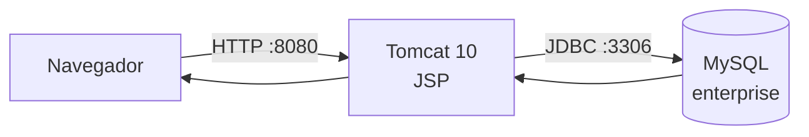
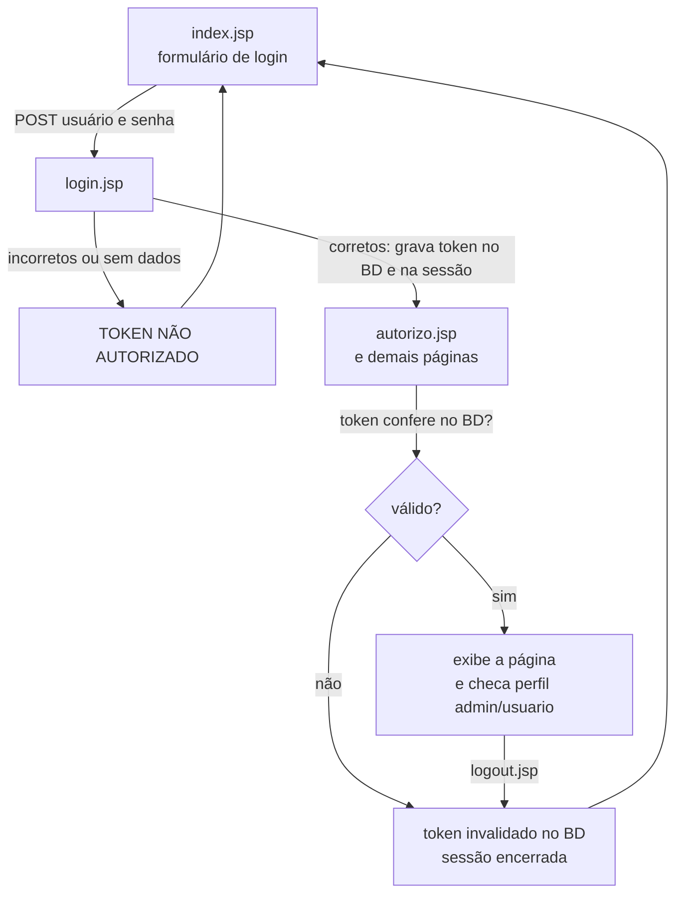

# Mini Estoque SaaS

Projeto da disciplina **Innovation Lab – SaaS Infrastructure** (Impacta).
Aplicação web em **3 camadas** implantada em uma VM Ubuntu (VMware), com **controle de sessão, autenticação e autorização**.

**Grupo:** _(nomes e RAs dos integrantes)_

## 1. Descrição da aplicação (ADR)

**Contexto:** uma pequena empresa precisa consultar e cadastrar produtos do estoque, e somente pessoas autorizadas podem acessar o sistema.

**Decisão:** aplicação JSP simples, hospedada em Tomcat 10 com MySQL, em que o *token de sessão* é gravado no banco e conferido **no banco** a cada página protegida.

**Consequências:** o servidor sempre sabe quem está autenticado (o token pode ser revogado no banco); em contrapartida, cada página faz uma consulta extra ao BD.

## 2. Arquitetura (3 camadas)

| Camada | Tecnologia | Função |
|---|---|---|
| 1 – Dados | MySQL 8 (banco `enterprise`) | Guarda usuários, tokens e produtos |
| 2 – Aplicação | Tomcat 10 + JSP (Java 17) | Regras de login, sessão e autorização |
| 3 – Apresentação | Navegador (HTML/CSS) | Telas para o usuário |

### Fluxo de dados



### Fluxo de autenticação e autorização



## 3. Estrutura do repositório

```
conf/script.sql          script do banco (usuário saas, banco enterprise, tabelas e dados)
conf/setenv.sh           variáveis de ambiente do serviço Tomcat (credenciais do BD)
scripts/deploy.sh        implanta o app no Tomcat da VM
webapp/                  aplicação (vai para /opt/tomcat10/webapps/estoque)
  index.jsp              formulário de login
  login.jsp              verifica usuário/senha e grava o token
  autorizo.jsp           área restrita (valida token)
  produtos.jsp           lista produtos; cadastro só para admin
  logout.jsp             revoga o token e encerra a sessão
  WEB-INF/web.xml        configuração XML do serviço (timeout de sessão, cookie HttpOnly)
  WEB-INF/includes/      trechos reutilizados (conexão e validação de token)
```

## 4. Modelo de dados

- **autenticacaoMais**(`tokenVigente`, `usuario`, `senha`, `perfil`, `sessaoUltima`, `dataHoraUltimaAutorizacao`) – PK (`tokenVigente`, `usuario`)
- **produto**(`idProduto`, `nome`, `categoria`, `quantidade`, `preco`, `dataCadastro`) – PK `idProduto`

## 5. Gerenciamento de sessão, autenticação e autorização

1. No início o token do usuário no banco é `sem-token` (nenhum valor válido).
2. `login.jsp` confere usuário e senha (hash SHA-256). Sem dados ou dados incorretos → *token não autorizado*.
3. Se corretos, o Id da sessão é renovado (`changeSessionId`) e gravado como `tokenVigente` no BD e na sessão.
4. **Toda página protegida** inclui `valida.jspf`, que confere o token **no banco** e se não expirou (30 min de inatividade). Se falhar, o token é invalidado e o usuário volta ao `index.jsp`.
5. **Autorização por perfil:** `admin` consulta e cadastra produtos; `usuario` apenas consulta (o servidor devolve 403 se um usuário comum tentar cadastrar).
6. `logout.jsp` revoga o token no banco e destrói a sessão.

Usuários de teste: `administrador / admin123` (admin) e `maria / user123` (usuario).

## 6. Como executar na VM

Veja o passo a passo em [`GUIA_VM.md`](GUIA_VM.md). Resumo:

```bash
git clone <URL-DO-REPOSITORIO>
cd <pasta-do-repositorio>
sudo ./scripts/deploy.sh
# acessar: http://IP_DA_VM:8080/estoque/
```

## 7. Problemas recorrentes em nuvem (e como o projeto lida)

| Problema | Tratamento / ideia |
|---|---|
| Credenciais do BD dentro do código | Lidas de variáveis de ambiente (`setenv.sh`) |
| Sessão que nunca expira | Timeout de 30 min no `web.xml` **e** no banco |
| Roubo/fixação de sessão | Cookie HttpOnly e Id da sessão renovado após o login |
| Serviço fora do ar (MySQL parado) | Mensagem de erro amigável; `systemctl status/restart mysql` |
| Várias instâncias da aplicação | O token fica no BD (não só na memória do Tomcat), o que facilita escalar |
| Rede da VM sem acesso | Reiniciar interface (`ip link set ens33 down/up`) e checar firewall (porta 8080) |

## 8. Limitações e melhorias futuras

- Hash SHA-256 sem *salt*: em produção usar bcrypt/Argon2 (o material de aula usa MD5, ainda mais fraco).
- Usar HTTPS (cookie `Secure`) e proteção CSRF nos formulários.
- Usuário do banco com privilégios mínimos (hoje tem `all privileges` no `enterprise`).
- Cadastro de usuários pela aplicação e edição/exclusão de produtos.

## 9. Checklist das tarefas

| Tarefa | Onde está |
|---|---|
| Esboço da aplicação e README | este arquivo |
| Script SQL para o SaaS | `conf/script.sql` |
| Repositório no GitHub | este repositório |
| Configuração do serviço (XML) | `webapp/WEB-INF/web.xml` |
| Operação com variáveis no serviço | `conf/setenv.sh` + `conexao.jspf` |
| Desenho do fluxo de dados | seção 2 |
| Problemas recorrentes em nuvem | seção 7 |
| Entrega final: sessão com autenticação e autorização | seção 5 + `webapp/` |
